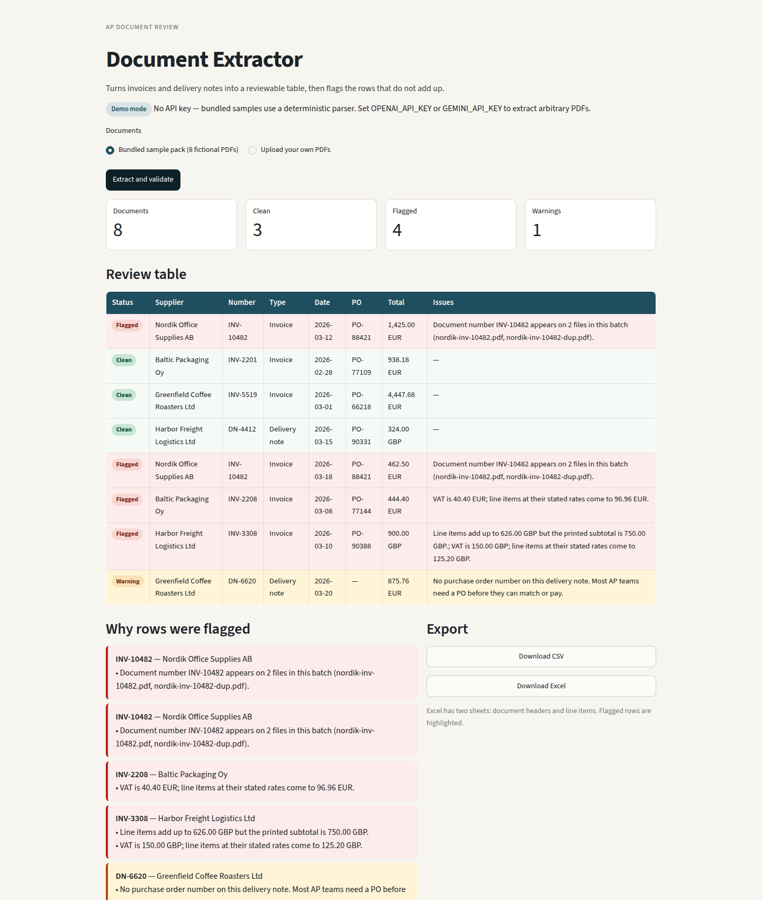
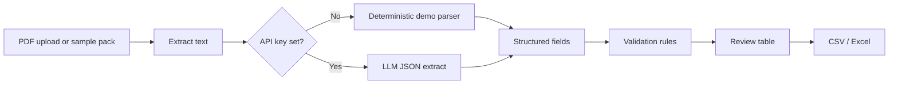

# Document Extractor

Turns invoices and delivery notes into a reviewable spreadsheet, and flags the ones that do not add up.

## The business problem

Accounts payable teams still spend a lot of time opening PDFs, typing supplier names, invoice numbers, dates, VAT and totals into a spreadsheet or an ERP, then checking whether the figures make sense. The expensive mistakes are ordinary: a VAT rate that does not match the lines, a total that does not match the lines, the same invoice number arriving twice, or a delivery with no purchase order to match against.

I built this as a small, honest version of that workflow. It is a portfolio project for [Stefan Istoc](https://github.com/stefandevelops) — I am moving from customer success and account management into AI automation, and I wanted something a hiring manager can run in a minute without asking me for keys or sample data.

## What it does

- Reads PDF invoices and delivery notes (bundled samples, or your own files).
- Pulls out supplier, document number, dates, PO, line items, VAT and totals.
- Checks that line items add up, that VAT maths holds, that invoice numbers are unique in the batch, and that a PO is present.
- Shows a review table with flagged rows highlighted and a plain-English reason for each issue.
- Exports the clean table to CSV or Excel.

In demo mode (no API key) a deterministic parser reads the bundled samples. If `OPENAI_API_KEY` or `GEMINI_API_KEY` is set, uploaded PDFs go through an LLM instead.

## Screenshot

The review table after running the eight fictional samples. Flagged rows are highlighted; the panel underneath spells out why.



## How it is put together



The demo parser looks for a stable `BEGIN_EXTRACT` block at the bottom of each bundled PDF, so the sample pack behaves the same on every machine. Validation is ordinary arithmetic — it does not depend on the model.

## Quickstart

```bash
python -m venv .venv && source .venv/bin/activate
pip install -r requirements.txt
streamlit run app.py
```

Open the URL Streamlit prints (usually http://localhost:8501), leave **Bundled sample pack** selected, and click **Extract and validate**.

To regenerate the sample PDFs:

```bash
python -m extractor.generate_samples
```

To extract PDFs that are not in the sample pack, copy `.env.example` to `.env` and set `OPENAI_API_KEY` or `GEMINI_API_KEY`. Streamlit picks up environment variables from the shell; it does not read `.env` by itself unless you export them.

```bash
export OPENAI_API_KEY=sk-...
streamlit run app.py
```

## How I'd take this to production

This MVP stops at a review table. A real AP rollout would need more than a better prompt.

- Keep a person in the loop. Auto-post only above a confidence threshold; everything else stays in a queue with the original PDF next to the extracted fields.
- Check duplicates against the ledger, not just the current batch, and match the PO to the purchase order line in the ERP.
- Add OCR for scans (AWS Textract, Google Document AI, or Azure Document Intelligence) before the LLM step. Text-layer PDFs are the easy case.
- Store an audit trail: who accepted or corrected a field, and which model version produced it.
- Build a small evaluation set of real, anonymised invoices per supplier. Prompt changes get measured, not guessed.
- Export into the system the finance team already uses (Fortnox, Xero, NetSuite) rather than leaving Excel as the destination.
- Treat documents as sensitive: retention limits, access control, and no training on customer files.

## Tech stack

- Python 3.12, Streamlit, Pydantic
- pypdf for text, reportlab for the fictional sample PDFs
- OpenAI-compatible API (OpenAI or Gemini) when a key is present
- openpyxl for Excel export
- pytest and GitHub Actions for CI

All sample documents are fictional. There is no real customer data in this repository.
